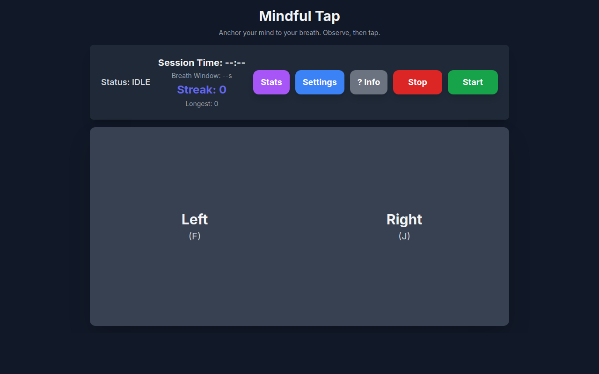
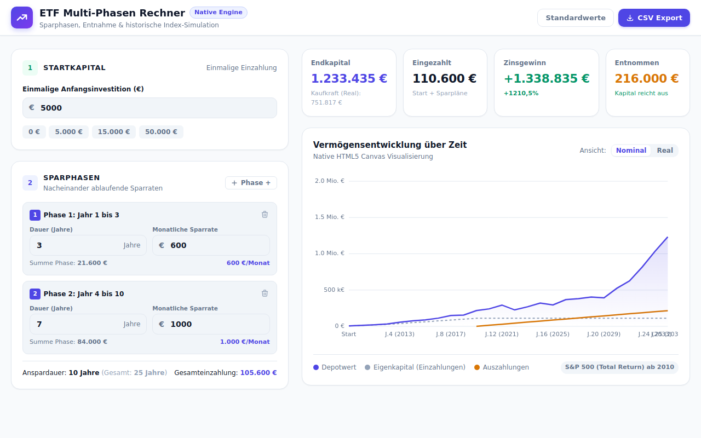
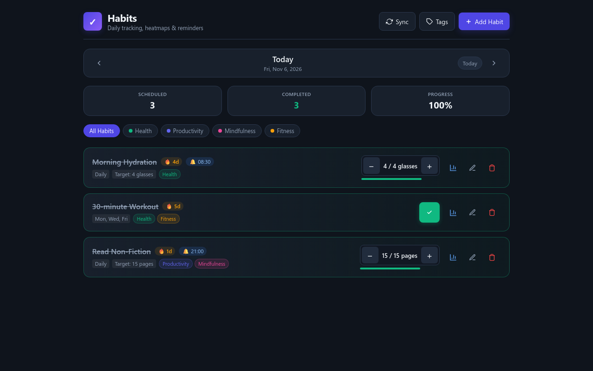

Apps I've built.

## Mindful Tap

A meditation game that keeps your attention on your breath. After each
full breath, tap the left or right side of the screen (or press F / J),
alternating sides, with a double tap every few breaths. Miss the focus
window and your streak resets. It has adjustable session length,
optional sound and vibration, a near-black screen mode, and a history of
your sessions with hit rates and an activity heatmap.

[Open the app](https://mufabo.codeberg.page/mindful_tap/) ·
[Source on Codeberg](https://codeberg.org/mufabo/mindful_tap)

## ETF-Sparplan-Rechner

An ETF savings plan calculator (in German). Combine an initial deposit
with several savings phases at different monthly rates, add a
withdrawal phase, and see how the portfolio develops. It can use fixed
returns or replay historical index data such as the S&P 500, and it
accounts for fund costs (TER) and inflation. You can switch between
nominal and real values and export the results as CSV.

[Open the app](https://mufabo.codeberg.page/etf-sparplan-rechner/) ·
[Source on Codeberg](https://codeberg.org/mufabo/etf-sparplan-rechner)

## Habit Tracker

A minimalist habit tracker. Habits can be simple done/not-done checks
or counters with a daily goal ("4 glasses", "15 pages"), and can repeat
every day, on chosen weekdays, or as an interval like twice a week. It
tracks streaks, shows statistics with a 90-day heatmap, sends optional
daily reminders, and lets you organise habits with tags. To use it on
several devices, it can sync your data through a private GitHub Gist.

[Open the app](https://mufabo.github.io/habit-tracker/) ·
[Source on GitHub](https://github.com/Mufabo/habit-tracker)
