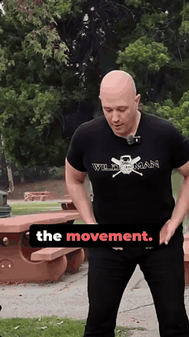
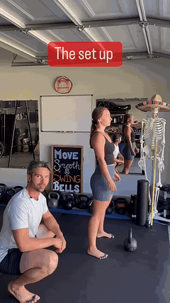
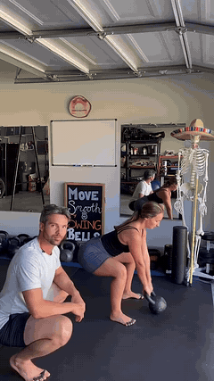
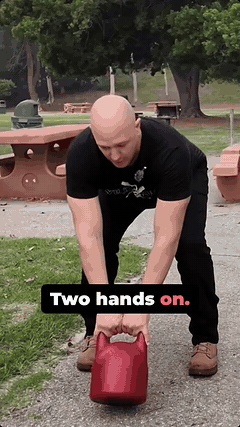
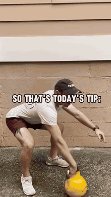
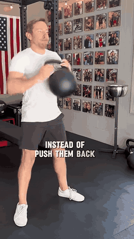
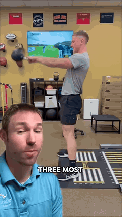
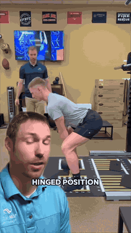
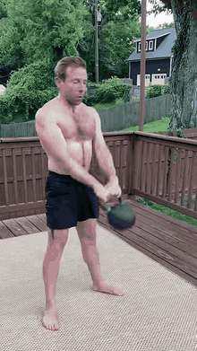
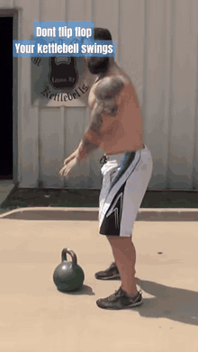

In a 2012 study, young men did kettlebell swings for 12 minutes, twice a week, for six weeks: 30 seconds of swings, 30 seconds of rest, with a 12 or 16 kg bell. A second group did jump squats, a well-established power exercise, instead. Across both groups, half-squat strength rose about 10% and jump height about 20%. The study detected no difference between the groups.[^4]

The swing is one movement and one piece of equipment. It trains the glutes, hamstrings and back extensors hard, doubles as conditioning, and takes up about two square metres of floor. It is also easy to do badly, and badly done it mostly trains your shoulders and irritates your lower back.

This post covers how to perform the swing, what weight to start with, six sample programs, and what the research shows (and doesn't show) about it.

## What the swing is

The swing is a **hip hinge** done explosively. You push your hips back with a fairly straight back and only a little knee bend, then snap them forward to stand tall. That snap sends the bell forward and up to about chest height. Your arms don't lift the bell; they connect it to your hips.

What follows is the **hardstyle** or Russian swing, as taught by StrongFirst and the RKC. The bell floats to roughly chest height. The CrossFit-style "American" swing goes overhead; it adds shoulder demand and makes the hip work less clear, so I leave it out here.

The swing belongs in the deadlift family, not the squat family. Mark Wildman's demo shows this well: hips go back, shins stay nearly vertical, and the spine stays in line from the crown of the head to the tailbone.

*Hip hinge: "push your hips back, crown to coccyx." Clip: [Mark Wildman, "The Perfect Two-Hand Kettlebell Swing"](https://www.youtube.com/shorts/BxD0eLea420).*

## How to perform a two-hand swing

### 1. Set up

- Stand with your feet about shoulder width apart, toes straight ahead or turned out slightly. This is not a wide sumo stance.
- Place the bell on the floor about a foot (30–45 cm) in front of you.
- Hinge: push your hips back until you can reach the handle with straight arms. Your back stays flat, your shins stay nearly vertical, and your hips sit higher than your knees.
- Grab the handle and **tilt the bell toward you**, so it becomes an extension of your arms.
- Pull your shoulders away from your ears and "lock in" your lats, as if you were trying to bend the handle. Keep your whole foot on the floor, with your weight over your midfoot and heels, and keep it there for the rest of the set.

*The setup: hinge, hook, tilt, then create tension and load your glutes and hamstrings. Clip: [Bij & Gab, "Your kettlebell swing is only as good as your set up"](https://www.youtube.com/shorts/ZAtoPYSgql0).*

### 2. Hike the bell

Start every set from the floor with a **hike**, like a centre snapping an American football. Throw the bell back between your legs, high up near your groin, not down by your knees. Your hips stay back and loaded, and your forearms touch your inner thighs.

*Hike the bell while keeping your hips back and loaded, then power with your hips. Clip: [Bij & Gab](https://www.youtube.com/shorts/ZAtoPYSgql0).*

### 3. Snap the hips and stand tall

Drive your whole foot into the floor and snap your hips forward until you are standing straight. At the top, everything is tight for a split second: glutes squeezed, abs braced, knees locked, quads pulled up. Your body forms a straight line from your heels to your head. The bell floats to about chest height because of momentum, not because you lifted it.

Breathing: inhale through your nose on the way down, and exhale sharply at the top ("tsss") as you brace.

 

*Two-hand swing, side and front view. Clips: [Mark Wildman](https://www.youtube.com/shorts/BxD0eLea420).*

### 4. Let the bell fall, then hinge late

On the way down, let gravity bring the bell back. Don't pull it down and don't hinge early. Wait until your upper arms touch your ribs, and **then** push your hips back and guide the bell between your legs. Zack Henderson calls this "catching the bell with the hips." If you hinge while the bell is still out in front, it drags your torso forward instead of loading your glutes and hamstrings.

*"Wait, wait, wait until the arm reconnects with the ribs, then catch the bell with the hips." Clip: [Zack Henderson, "POWERFUL kettlebell swings"](https://www.youtube.com/shorts/mGL9BAQ5p2g).*

### 5. Park it

At the end of a set, don't stop the bell at the top or let it clunk down in front of you. On the last rep, let it swing back between your legs one more time, then let it float forward and set it down where you picked it up. This is the setup in reverse.

## Common faults

### Squatting the swing

This is the most common fault. Instead of pushing the hips back, people drop them down. The knees travel forward and the torso stays upright. That's a squat, and you can't snap your hips from a squat. Your quads do the work and your arms finish the job.

*"A common mistake is when people drop the hips instead of pushing them back. That's a squat." Clip: [Zack Henderson, "STOP squatting your kettlebell swings"](https://www.youtube.com/shorts/FsaNkwqRI_g).*

### Squat to front raise, scooping, leaning back

Squat University's Aaron Horschig shows a lifter whose swing combined three faults:

- the bottom was a squat;
- on the way up, he scooped his hips forward;
- at the top, he leaned back.

The lifter had reported back pain for several months, and Horschig attributes it to the scoop into the top position. A short clip can't establish that, but the form correction is worth copying either way: slide the hands down toward the knees to practise a pure hinge, shift the weight back onto the whole foot, and finish in a straight line from head to heels.

 

*Before and after. Clips: [Squat University, "She Did Kettlebell Swings WRONG!"](https://www.youtube.com/shorts/lJFChol_LfQ).*

### Over-extending at the top

Trying to swing harder often means throwing the hips past vertical. The knees unlock and your lower back takes the hit. Put your effort into standing **tall**, not pushing forward.

*"Your effort should be tall, not forward." Clip: [Zack Henderson, "Kettlebell swing tip: lock out tall!"](https://www.youtube.com/shorts/SlFTn9RmAlY).*

### Hiking low and getting hit

If the bell passes low between your knees, or the bell flips over and hits your backside, you hiked too low and too loosely. Keep the handle high in your groin and your forearms against your thighs.

*"There should not be a flip-flop when it goes between your legs." Clip: [Joe Daniels, "Kettlebell Swings Shouldn't Hit your Butt!"](https://www.youtube.com/shorts/vCJwz74YLnY).*

### Other faults

- **Lifting with the arms.** On side-view video, watch what happens after your hips have finished extending. If your arms keep actively raising the bell from there, you are adding a front raise. The bell should float on momentum alone; your arms are ropes.
- **Rocking on your toes.** Keep your whole foot down and drive through the midfoot. Soft, cushioned running shoes make this harder; flat shoes or bare feet help.[^yt1]
- **Rounding your back at the bottom.** Usually from hinging too early or using a bell that is too heavy.
- **Looking up at the ceiling.** Keep your neck in line with your spine. At the bottom, your eyes look at the floor a couple of metres ahead.

## Learn the hinge before you swing

If you have never deadlifted, spend your first sessions on drills rather than swings:

1. **Wall hinge.** Stand a foot from a wall, facing away, and push your hips back until your backside touches it. Move a little further away each time.
2. **Kettlebell deadlift.** Bell between your feet, hinge, and stand up. Several sets of 5.
3. **Hike and park.** Set up, hike the bell back, then park it on the floor again. No swing. This teaches the loaded position.
4. **Hike and stand.** Hike, snap up to standing with the bell hanging (the "chop and pop" drill), then park.
5. **Single swings.** One swing, park, reset. Then sets of 5.

Film yourself from the side. Most faults are obvious on video and invisible from the inside.

## Which kettlebell weight?

The swing is ballistic. Momentum and hip power move the bell, so you can swing much more than you could curl or press. Too light is actually a common mistake: a light bell is easy to muscle up with your arms and doesn't force a proper hinge.

Typical starting weights for the two-hand swing:

| | Untrained | Some lifting experience | Strong / experienced |
|---|---|---|---|
| **Women** | 8 kg | 12 kg | 16 kg |
| **Men** | 12–16 kg | 16–20 kg | 24 kg |

These match common coaching guidance[^9] and the loads used in studies: 16 kg for men and 8 kg for women,[^2][^3][^5] or 12–16 kg depending on body weight.[^4]

To make progress, move to the next bell size, one step up from your current bell (usually 4 kg heavier: 8 → 12 → 16 → 20 → 24 kg), once you can do five clean sets of 10 with your current bell. Expect your first sets with the new bell to be shorter again.

For long-term goals, StrongFirst's *Simple & Sinister* sets timed standards for 100 one-arm swings in 5 minutes:[^10]

- **"Simple":** 32 kg for men, 24 kg for women.
- **"Sinister":** 48 kg for men, 32 kg for women.

Most people take a long time to reach "Simple," and "Sinister" is elite.

If you buy only one bell, pick it from the table above: the weight for your experience level, not one size heavier "to grow into." Get a cast-iron bell with a smooth, unpainted or powder-coated handle, wide enough for both hands. Competition bells (same size at every weight) are fine too.

## Sample programs

All of these assume your technique is solid. Count only good reps; when form breaks down, end the set. Rest as long as you need between sets in the first weeks. Swings are demanding, but your hamstrings and grip adapt quickly.

### 1. Beginner: learning the swing (weeks 1–3)

Two to three sessions a week, on non-consecutive days.

- Hinge drills and kettlebell deadlifts: 3 × 5
- Hike and park: 3 × 5
- Two-hand swings, resting fully between sets:
  - week 1: 5 sets of 5 (25 swings)
  - week 2: 5 sets of 8 (40 swings)
  - week 3: 5 sets of 10 (50 swings)

If a week's sets aren't clean, repeat that week before moving on.

### 2. Swing EMOM: 100 swings in 10 minutes

At the start of every minute, do 10 two-hand swings and rest for the remainder of the minute. Ten rounds makes 100 swings. Start with 5 rounds and add one round a session. When 10 rounds feel easy, go up a bell or move on to one-arm swings.

### 3. Intervals from the Lake & Lauder study

12 rounds of 30 seconds of swings, 30 seconds of rest, twice a week. That's 12 minutes in total. This is the swing group's protocol from the 2012 trial, where swing and jump-squat groups both gained strength and jump height.[^4] A 2024 study used the same 12 × 30 s/30 s scheme for 12 weeks with experienced lifters and also reported strength and jump gains, though without a control group.[^13]

### 4. Simple & Sinister swing block

Based on Pavel Tsatsouline's *Kettlebell Simple & Sinister* (revised and updated edition, 2019) as summarised by StrongFirst.[^10] The program's session is 100 one-arm swings in 10 sets of 10, switching hands each set, followed by 10 Turkish get-ups. Leave out the get-ups if you only want the swing part.

Two things are easy to blur here:

- **Daily practice.** This is what you do most days. Rest as long as you need between sets so every rep stays crisp; the session is meant to leave you fresher, not wrecked. My own adaptation: rest until your breathing has calmed enough to talk in full sentences.
- **The timed test.** 100 swings in 5 minutes. One way to pace it is to start a set every 30 seconds. It's a benchmark you test occasionally, not the daily pace. My own rule (not the book's): once I pass it comfortably with my current bell, I start practising with the next size.

The book's own load-cycling schedule is more detailed than this; read it if you want to follow the program exactly.

### 5. Dan John's 10,000 swing challenge

10,000 swings in about four weeks: 500 swings per session, 20 sessions, four to five sessions a week.[^11] Men typically use 24 kg, women 16 kg. The commonly cited set scheme:

- Swings in sets of 10, 15, 25, 50 (100 swings), repeated five times.
- Between swing sets, do a few reps of a strength exercise. Rotate presses, chin-ups, dips or goblet squats from session to session.

This is an advanced challenge; Dan John has a whole video on [when you are ready for it](https://www.youtube.com/watch?v=PBuH6W_kQ9o). You should already swing well and be able to recover from high volume. If your hands tear or your back aches, stop.

### 6. Challenge: 100 swings a day

Do 100 swings every day for a month, in whatever sets you like. Zack Henderson runs it as a public challenge. It's lighter than the 10,000 swing challenge, but it is not a beginner plan: it doubles the week-three session of the beginner block and removes the rest days. Try it only once you already handle 100 swings a session, several times a week, without sore hands or an achy back.

The BELL trial in older adults (more on that below) included a month of 100 swings a day, but as one part of a supervised, multicomponent kettlebell program, not as a standalone challenge.[^15]

## What the research says

The swing has been studied more than most single exercises, but almost all of the studies are small (10–40 participants) and short (one session to 12 weeks). The 2019 scoping review by Meigh and colleagues covered 99 kettlebell publications. It found that effect sizes were mostly trivial to small, and that our confidence in them is low to very low.[^14] Keep that in mind while reading the results below.

### Strength and power

- **Lake & Lauder (2012).** 21 young men; swings (12 × 30 s/30 s, twice a week, 6 weeks) or jump squats. Across both groups, half-squat strength rose about 10% and jump height about 20%. The study detected no difference between the groups. There was no untrained control group, so we can't tell how much of the gain the training itself caused.[^4]
- **Otto et al. (2012).** 30 men did either weightlifting (high pulls, power cleans, back squats) or kettlebell work (swings, accelerated swings, goblet squats), twice a week for 6 weeks. Both groups improved, but squat strength rose more in the weightlifting group. Vertical jump and body composition didn't differ between groups.[^6]
- **Santos Junior et al. (2024).** 53 trained men and women, 12 × 30 s maximal swings, twice a week for 12 weeks. Deadlift 1RM rose by about 12% in both sexes and countermovement jump by 13% in men and 7% in women. There was no control group.[^13]

My take: swings are a good tool for hip power and decent for strength, especially for people who don't lift heavy. They don't replace heavy squats or deadlifts for maximal strength.

### Conditioning and heart rate

- **Farrar et al. (2010).** 10 men did as many two-hand swings as they could in 12 minutes with a 16 kg bell, averaging 265. Heart rate averaged 87% of maximum, but oxygen uptake only 65% of VO2max. Heart rate overstates how aerobic swings are.[^1]
- **Hulsey et al. (2012).** 10 minutes of swings (35 s on / 25 s off) compared with treadmill running at the same perceived effort. Heart rate and perceived effort were the same, but running burned 25–39% more energy. Heart rate during the swings averaged about 90% of age-predicted maximum, which falls within the American College of Sports Medicine's (ACSM) intensity range for aerobic training. That describes the intensity of a single session; the study didn't measure any change in fitness.[^5]
- **Falatic et al. (2015).** This was a snatch study, not a swing study, but it's often quoted. Women soccer players added 20 minutes of 15 s on / 15 s off kettlebell snatches, three times a week for 4 weeks. VO2max went up about 6%; a circuit-training group didn't improve.[^7]

### Back pain and the lower back

- **Jay et al. (2011).** 40 adults from jobs with high rates of musculoskeletal pain did kettlebell training three times a week for 8 weeks. Compared with controls, neck and shoulder pain fell by 2.1 points on a 0–10 scale, and low back pain by 1.4 points. Trunk extensor strength increased; aerobic fitness did not.[^2] A follow-up from the same trial found faster recovery from sudden balance perturbations.[^8]
- **McGill & Marshall (2012).** A biomechanics study of 7 men swinging a 16 kg bell. Back extensors reached about 50% of maximal activation, glutes about 80%. The estimated compression on the lower spine was about 3,200 N. Unusually, the swing shears the lower spine in the opposite direction to a normal lift. The authors suggest this may explain why many people say swings help their backs while a few find they aggravate them.[^3]

### Which muscles work

- **Zebis et al. (2013).** In 16 elite female handball and soccer players, the swing (along with the Romanian deadlift) worked the inner hamstring (semitendinosus) harder than the outer one. Activation was 73–115% of maximum. That is relevant for hamstring injury rehab.[^12]
- **Van Gelder et al. (2015).** 23 young adults; glutes and hamstrings both peaked at roughly 75–80% of maximal voluntary activation, with very large differences between individuals. The hamstrings fired first.[^16]
- **Andersen et al. (2016).** One-arm swings activated the opposite side of the upper back about 24% more than the same side. Lower-back activity was similar for one- and two-arm swings.[^17]

### Older adults

- **The BELL trial (Meigh et al., 2022).** 32 insufficiently active adults aged 59–79 went through 12 weeks of normal life, then 12 weeks of supervised hardstyle kettlebell training covering several exercises, which included a month of 100 swings a day. Compared with the control period:
  - grip strength rose by 6–7 kg;
  - 6-minute walk distance rose by 42 m;
  - deadlift 1RM rose by 16 kg;
  - resting heart rate fell by 7 beats per minute.

  There was no randomised control group, and the lead author is a kettlebell instructor (which he declares).[^15]
- **Chen et al. (2018).** 33 women aged 65–75 with sarcopenia. Eight weeks of kettlebell training, twice a week, increased muscle mass, grip strength and back strength compared with controls, and the gains persisted after 4 weeks of detraining.[^18]

### What we don't know

There are no large or long-term trials. There are hardly any comparisons with a matched barbell program at equal effort. Almost nothing has been published on hypertrophy. A practical article from Dr. Muscle sums up the hypertrophy case fairly: swings build the posterior chain and conditioning, but for muscle growth you still want heavier compound lifts in the 8–12 rep range.[^19]

## Summary

- **Technique:** Hinge, don't squat. Hike high. Snap your hips and finish tall, not leaning back. Hinge late on the way down. Your arms are ropes.
- **Weight:** Untrained women usually start with 8 kg and untrained men with 12–16 kg; go one size heavier if you already lift. Move up one bell size at a time once five clean sets of 10 feel solid.
- **Programs:** Start with drills, then build from 5 × 5 to 5 × 10 over three weeks. Then 10 × 10 on the minute, 30 s/30 s intervals, or *Simple & Sinister*. Save the 100-a-day and 10,000 swing challenges for when your technique is solid and you already tolerate the volume.
- **Evidence:** In small, short studies, swing training improved hip power and strength. One small trial found lower self-reported low-back pain after eight weeks of kettlebell training. Swings raise your heart rate more than your oxygen uptake. The overall quality of the evidence is low.

## Further watching

The GIFs above are short clips; the full videos have more detail:

- [How To Kettlebell Swing (Ultimate Guide)](https://www.youtube.com/watch?v=O9pivupBhuc) and [in 3 minutes](https://www.youtube.com/watch?v=bDCeXbMJVNs), Zack Henderson
- [Hinge Don't Fold: Fixing Your Swing](https://www.youtube.com/watch?v=-t9fdhvGmsU) and [How to Fix Low Back Pain From Kettlebell Swings](https://www.youtube.com/watch?v=HB2sXerxtwA), Dan John
- [When Are You Ready for the 10,000 Swing Challenge](https://www.youtube.com/watch?v=PBuH6W_kQ9o), Dan John
- [Kettlebell Swing Tutorial: Two Arm Swing, Proper Form & Progressions](https://www.youtube.com/watch?v=1Qi0NQW89Oc), Brittany van Schravendijk
- [How To: Single-Arm Kettlebell Swing](https://www.youtube.com/watch?v=5i_xp1vtkc4), Zack Henderson
- [Your Kettlebell Swing Form: Five Tips to Prevent Injury](https://www.youtube.com/watch?v=uGGdhwJ0Y-4), Joe Daniels
- [How To Do Kettlebell Swings: Proper Form To Avoid Pain And Injury](https://www.youtube.com/watch?v=hp3qVqIHNOI), Dr. Carl Baird
- [The BEST Kettlebell Swing Cues](https://www.youtube.com/watch?v=oWDAe3b4b2k) and [How to do KETTLEBELL SWING (Use Your Hips!)](https://www.youtube.com/watch?v=Buz6gaVzVZs), Mark Bell's Super Training Gym
- [STOP DOING SH*TTY KETTLEBELL SWINGS](https://www.youtube.com/watch?v=zSww9F2ZEW8), Kelly Matthews
- [The BEST Kettlebell Swing Tutorial](https://www.youtube.com/shorts/aSYap2yhW8s) and [Correctly Perform Kettlebell Swings!](https://www.youtube.com/shorts/2gXtvqLa_T8), Squat University

[^1]: [Oxygen cost of kettlebell swings](https://pubmed.ncbi.nlm.nih.gov/20300022/), Farrar, Mayhew & Koch, *Journal of Strength and Conditioning Research*, 2010.
[^2]: [Kettlebell training for musculoskeletal and cardiovascular health: a randomized controlled trial](https://pubmed.ncbi.nlm.nih.gov/21107513/), Jay et al., *Scandinavian Journal of Work, Environment & Health*, 2011.
[^3]: [Kettlebell swing, snatch, and bottoms-up carry: back and hip muscle activation, motion, and low back loads](https://pubmed.ncbi.nlm.nih.gov/21997449/), McGill & Marshall, *Journal of Strength and Conditioning Research*, 2012.
[^4]: [Kettlebell swing training improves maximal and explosive strength](https://pubmed.ncbi.nlm.nih.gov/22580981/), Lake & Lauder, *Journal of Strength and Conditioning Research*, 2012.
[^5]: [Comparison of kettlebell swings and treadmill running at equivalent rating of perceived exertion values](https://pubmed.ncbi.nlm.nih.gov/22395274/), Hulsey, Soto, Koch & Mayhew, *Journal of Strength and Conditioning Research*, 2012.
[^6]: [Effects of weightlifting vs. kettlebell training on vertical jump, strength, and body composition](https://pubmed.ncbi.nlm.nih.gov/22344061/), Otto, Coburn, Brown & Spiering, *Journal of Strength and Conditioning Research*, 2012.
[^7]: [Effects of Kettlebell Training on Aerobic Capacity](https://pubmed.ncbi.nlm.nih.gov/26102260/), Falatic et al., *Journal of Strength and Conditioning Research*, 2015.
[^8]: [Effects of kettlebell training on postural coordination and jump performance: a randomized controlled trial](https://pubmed.ncbi.nlm.nih.gov/22843044/), Jay et al., *Journal of Strength and Conditioning Research*, 2013.
[^9]: [What Is the Best Kettlebell Weight to Start With?](https://www.onnit.com/academy/what-is-the-best-kettlebell-weight-to-start-with), Onnit Academy.
[^10]: [Kettlebell Simple & Sinister](https://www.strongfirst.com/sinister/), Pavel Tsatsouline, StrongFirst.
[^11]: [Insights from the 10,000 Rep Challenge](https://medium.com/@danjohn84123/insights-from-the-10-000-rep-challenge-d6a01c32c89f), Dan John.
[^12]: [Kettlebell swing targets semitendinosus and supine leg curl targets biceps femoris: an EMG study with rehabilitation implications](https://pubmed.ncbi.nlm.nih.gov/22736206/), Zebis et al., *British Journal of Sports Medicine*, 2013.
[^13]: [Sex Differences in Neuromuscular Adaptations Following 12 Weeks of Kettlebell Swing Training](https://pmc.ncbi.nlm.nih.gov/articles/PMC11524543/), Santos Junior et al., *Cureus*, 2024.
[^14]: [Kettlebell training in clinical practice: a scoping review](https://pmc.ncbi.nlm.nih.gov/articles/PMC6719359/), Meigh, Keogh, Schram & Hing, *BMC Sports Science, Medicine and Rehabilitation*, 2019.
[^15]: [Effects of supervised high-intensity hardstyle kettlebell training on grip strength and health-related physical fitness in insufficiently active older adults: the BELL pragmatic controlled trial](https://pmc.ncbi.nlm.nih.gov/articles/PMC9026020/), Meigh et al., *BMC Geriatrics*, 2022.
[^16]: [EMG Analysis and Sagittal Plane Kinematics of the Two-Handed and Single-Handed Kettlebell Swing: A Descriptive Study](https://pmc.ncbi.nlm.nih.gov/articles/PMC4637916/), Van Gelder et al., *International Journal of Sports Physical Therapy*, 2015.
[^17]: [Core Muscle Activation in One-Armed and Two-Armed Kettlebell Swing](https://pubmed.ncbi.nlm.nih.gov/26473519/), Andersen et al., *Journal of Strength and Conditioning Research*, 2016.
[^18]: [Effects of 8-week kettlebell training on body composition, muscle strength, pulmonary function, and chronic low-grade inflammation in elderly women with sarcopenia](https://pubmed.ncbi.nlm.nih.gov/30243898/), Chen et al., *Experimental Gerontology*, 2018.
[^19]: [Maximize Hypertrophy with Kettlebell Swings](https://dr-muscle.com/maximize-hypertrophy-with-kettlebell-swings/), Dr. Muscle Editorial Team.
[^yt1]: [Kettlebell swing PRO TIP](https://www.youtube.com/shorts/uIcE5ehBVOM), Zack Henderson.
